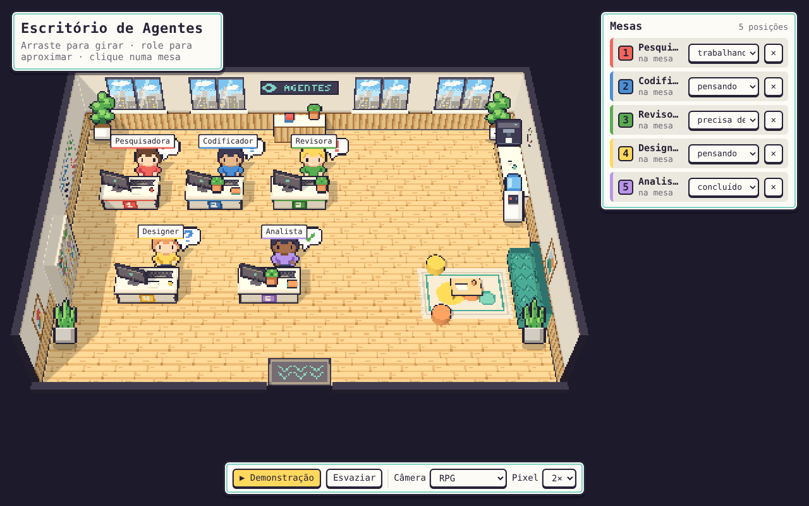
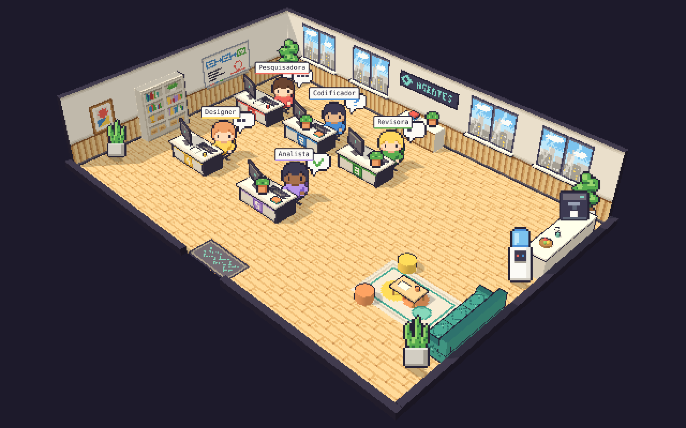
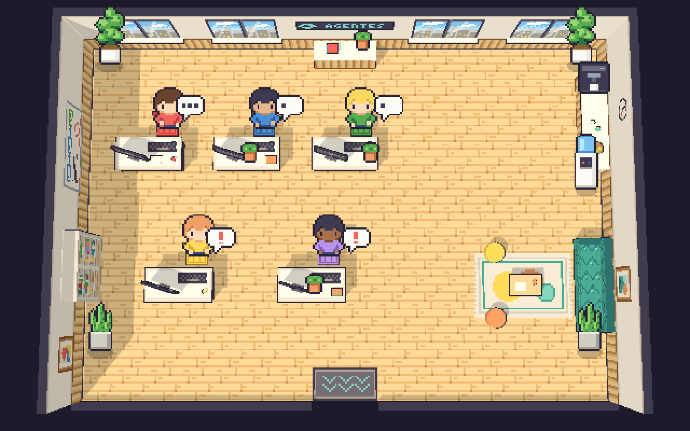

# Escritório de Agentes 3D



Cenário 3D de um escritório moderno com **5 mesas** prontas para receber agentes animados.
O visual segue o padrão dos RPGs de bolso (a linguagem visual dos jogos Pokémon de GBA/DS):
grade de 16 px, câmera inclinada em 3/4, paleta clara e saturada, contornos escuros, balões de
emoção sobre a cabeça, capacho de entrada e personagens que andam tile a tile em 4 direções.

Toda a arte foi desenhada como código com a skill [`pxl-pixel-art`](../.claude/skills/pxl-pixel-art/SKILL.md)
deste repositório e é original: sem pokébolas, criaturas, logotipos ou tiles dos jogos.

| Isométrica | De cima |
| --- | --- |
|  |  |

## Rodar

```bash
cd escritorio-3d
npm run servir          # = python3 -m http.server 8080 (ou: npx serve .)
# abra http://localhost:8080/?demo=1
```

A página usa ES modules e carrega texturas, por isso precisa de um servidor HTTP (abrir o
`index.html` direto do disco não funciona). O Three.js vem do jsDelivr, com a versão fixada em 0.170.0.

| Parâmetro de URL | Efeito |
| --- | --- |
| `demo=1` | os 5 agentes de demonstração entram pela porta e sentam |
| `camera=rpg` \| `isometrica` \| `topo` | câmera inicial (padrão `rpg`) |
| `pixel=1..4` | tamanho do pixel na tela (padrão `2`) |
| `ui=0` | esconde a interface (para usar em `<iframe>`) |

Arraste para girar, use a roda do mouse (ou pinça) para aproximar e clique numa mesa para destacá-la no painel.
Quando a câmera gira para fora de uma parede lateral, essa parede é recortada na altura do rodapé,
como nos jogos isométricos, para não esconder a sala.

## A sala

O layout é um mapa de tiles (`src/layout.js`), como os mapas dos jogos. A câmera olha para o norte;
a linha 0 encosta na parede do fundo e a linha 10 é a entrada.

```
   0123456789012345
 0 P......CC......P     P/p plantas   C aparador (sob o letreiro)
 1 ...............B     B balcão do café   A bebedouro
 2 ..s..s..s......B     m mesa (2 tiles)   s assento da mesa
 3 .mm.mm.mm......B     E estante   F sofá   O pufes   t mesinha
 4 ...............A     D capacho da entrada (onde os agentes surgem)
 5 ................
 6 E..s...s....O..F
 7 E.mm..mm.....t.F
 8 ............O..F
 9 p..............p
10 .......DD.......
```

| Mesa | Cor | Tiles da mesa (col, lin) | Assento (col, lin) |
| --- | --- | --- | --- |
| 1 | vermelha `#f2665c` | (1,3)–(2,3) | (2,2) |
| 2 | azul `#4a8fd6` | (4,3)–(5,3) | (5,2) |
| 3 | verde `#58ad4f` | (7,3)–(8,3) | (8,2) |
| 4 | amarela `#ffd85e` | (2,7)–(3,7) | (3,6) |
| 5 | roxa `#b995ea` | (6,7)–(7,7) | (7,6) |

Cada mesa tem tampo branco, pés pretos, painel frontal com faixa e plaquinha numerada na cor
da mesa, monitor (a tela mostra código rolando quando o agente trabalha), teclado, mouse,
objetos pessoais e cadeira estofada na mesma cor. Enquanto a mesa está livre, uma seta da cor
dela quica sobre a cadeira. O agente senta virado para a câmera.

No resto da sala: janelões com vista da cidade, letreiro "AGENTES", quadro branco com o fluxo
dos agentes, estante, quadros, relógio, café (balcão ripado, máquina de espresso, bebedouro,
fruteira) e área de descanso (sofá capitonê, tapete, pufes e mesinha).

## Alocando agentes

A página expõe `window.escritorio`:

```js
// entra pelo capacho, anda até a mesa 2 e senta; a promessa resolve quando ele senta
await escritorio.alocarAgente(2, { nome: "Pesquisadora", status: "trabalhando" });

escritorio.definirStatus(2, "pensando");   // troca o balão e a tela do monitor
await escritorio.liberarMesa(2);           // levanta e sai pela porta
escritorio.mesas();                        // [{ id, cor, livre, agente, assento, posicao }]
```

| Método | O que faz |
| --- | --- |
| `alocarAgente(mesa, { nome, status, visual, entrarPelaPorta })` | coloca um agente na mesa 1–5. `visual` é 1–5 (agentes de demonstração) ou o nome de outra folha `agente_<id>`; `entrarPelaPorta: false` faz ele já aparecer sentado. Rejeita se a mesa estiver ocupada. |
| `liberarMesa(mesa, { sairPelaPorta })` | o agente sai pela porta; resolve quando ele some. |
| `definirStatus(mesa, status)` | `trabalhando`, `pensando`, `alerta`, `concluido`, `ocioso` ou `nenhum`. |
| `mesas()` | estado das 5 mesas, com a posição 3D de cada assento. |
| `camera(nome)` | `rpg`, `isometrica` ou `topo`. |
| `demonstracao()` / `esvaziar()` | enche/esvazia o escritório com os agentes de demonstração. |

| Status | Balão | Animação | Monitor |
| --- | --- | --- | --- |
| `trabalhando` | "…" animado | digitando | código rolando |
| `pensando` | "?" | parado | código |
| `alerta` | "!" (quicando) | parado | código |
| `concluido` | ✓ | parado | descanso de tela |
| `ocioso` | "Z" animado | parado | descanso de tela |
| `nenhum` | — | digitando | código rolando |

Também dá para controlar de fora, com a página dentro de um `<iframe>`:

```js
iframe.contentWindow.postMessage({ escritorio: "alocarAgente", args: [3, { nome: "Revisora" }], id: 1 }, "*");
// resposta: { escritorioResposta: 1, ok: true, resultado: { mesa: 3, ... } }
```

## Como foi feito

```
escritorio-3d/
├── arte/escritorio.px.js     toda a pixel art, na DSL da skill pxl
├── assets/                   PNGs gerados + manifest.json (npm run arte)
├── ferramentas/pxl-lite.mjs  renderizador da DSL (veja abaixo)
├── src/layout.js             mapa de tiles, mesas e caminho (BFS em 4 direções)
├── src/cena.js               sala, paredes recortáveis, mesas, café, lounge
├── src/agentes.js            agentes: chegada, caminhada, sentar, status, saída
├── src/recursos.js           texturas sem suavização + billboards de pixel art
├── src/main.js               renderizador pixelado, câmeras, interface e API
└── index.html
```

- **Pixels nítidos:** a cena é renderizada em 1/N da resolução da tela e ampliada com
  `image-rendering: pixelated`; as texturas usam filtro `Nearest`. Os móveis têm contorno escuro
  (casco invertido), como os sprites dos jogos.
- **Sprites no 3D:** plantas, bebedouro, balões e agentes são billboards de pixel art virados para a
  câmera. A profundidade de cada sprite é calculada como se ele fosse um plano em pé no próprio pé.
  Assim ele passa na frente de mesas que estão atrás, fica atrás da mesa em que está sentado e não
  atravessa a parede, sem perder o desenho de frente.
- **Direção relativa à câmera:** ao girar a câmera, o agente mostra o sprite certo (frente, costas
  ou perfil) para a direção em que anda na tela.

## Novos visuais de agente

Cada folha `agente_<id>` (16×24 px por quadro) junta quatro animações:

| Animação | Quadros |
| --- | --- |
| `_frente_<id>` | parado, passo, outro passo (olhando para a câmera) |
| `_costas_<id>` | parado, passo, outro passo |
| `_lado_<id>` | parado, passo, outro passo (olhando para a esquerda; a direita é espelhada) |
| `_sentado_<id>` | 2 quadros digitando |

Para criar um visual novo, troque as cores da base no `arte/escritorio.px.js`
(chaves: `x/X` camisa, `h/H` cabelo, `c/C` pele, `j/J` calça):

```js
const swap = { x: "T", X: "y", h: "v", H: "V" }   // camisa teal, cabelo grisalho
for (const pose of ["frente", "costas", "lado", "sentado"])
  anim("_" + pose + "_chefe", { base: "agente_" + pose, swap })
sheet("agente_chefe", ["_frente_chefe", "_costas_chefe", "_lado_chefe", "_sentado_chefe"])
```

Depois rode `npm run arte` e use `escritorio.alocarAgente(1, { visual: "agente_chefe" })`.

## Sobre o `pxl-lite`

O `SKILL.md` da skill `pxl-pixel-art` manda rodar `bin/pxl.js`, mas esse executável (e o
`reference.md`) não estão no repositório; só o `SKILL.md` foi versionado. Para gerar a arte,
`ferramentas/pxl-lite.mjs` implementa o subconjunto da DSL usado aqui, com as assinaturas do
`SKILL.md`: `pal`, `ramps`, `use`, `sprite`, `anim`/`frame`, `scene`, `layer` (inclusive
`shade: true`), `sheet`, `clip`, as formas (`px rect box hline vline line circ ring ellipse poly fill text grid`),
os tons (`shade light dither grad noise recolor`), `stamp`/`tile` e as opções `w h mx my outline base swap flip bg fps`.
Ele grava `assets/<nome>.png`, prévias ampliadas em `assets/_preview/` e um `manifest.json` com
tamanho, quadros e retângulos das folhas.

```bash
npm run arte                                                        # gera tudo
node ferramentas/pxl-lite.mjs build arte/escritorio.px.js --out assets --only agente_1
node ferramentas/pxl-lite.mjs ascii arte/escritorio.px.js seta_livre   # grade com réguas
```

Detalhes que o `SKILL.md` não define e que o `pxl-lite` escolheu: com `mx`, a largura informada é a
final e a metade esquerda é espelhada; `grad(x, y, w, h, "chaves", { dir })`; o `manifest.json`.
Quando o `pxl` completo for adicionado à skill, o mesmo `arte/escritorio.px.js` deve rodar com ele
(o `manifest.json` é específico do `pxl-lite`).
